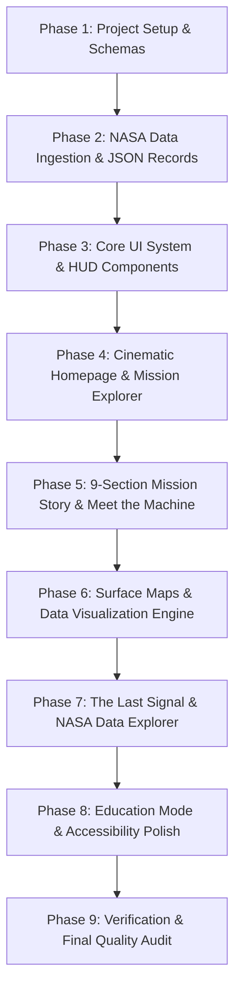

# DEVELOPMENT PLAN — SPACE GRAVEYARD
> **"Every machine left a footprint. Every footprint tells a story."**  
> *2026 NASA Space Apps Challenge Implementation Roadmap*

---

## MVP Scope Definition & Feature Prioritization

### P0 — Must Have (Core MVP Scope)
- [ ] **Cinematic Homepage**: Hero section with space telemetry theme, challenge overview, statistics counter, and "Explore Machines" CTA.
- [ ] **Mission Explorer**: Interactive filter bar by Celestial Body (Moon/Mars), Hardware Type (Rover, Lander, EDL, Stage), and Status (Abandoned, Completed, Silent).
- [ ] **9-Section Mission Story Engine**: Standardized page layout adhering strictly to the 9 storytelling steps:
  1. *Why Did We Send It?*
  2. *Meet the Machine*
  3. *The Journey*
  4. *What Did It Do?*
  5. *What Did It Discover?*
  6. *The Science*
  7. *The Final Moment*
  8. *Where Is It Now?*
  9. *Why Does It Still Matter?*
- [ ] **Meet the Machine Hardware View**: Subsystem breakdown, payload instruments, dimensions, mass, power source, and purpose specs.
- [ ] **Mission Timeline**: Chronological events from launch to final signal.
- [ ] **Surface Map**: Accurate NASA latitude/longitude plot on Moon & Mars maps (never invented coordinates).
- [ ] **Data Visualizations**: Telemetry/traverse charts annotated with **WHAT**, **WHY**, and **WHERE**.
- [ ] **The Last Signal**: Telemetry highlight showing last communication date, cause of silence, final location, and scientific legacy.
- [ ] **NASA Data Explorer**: Dataset provenance table with trust levels (`FACT`, `DATA`, `INTERPRETATION`), dataset IDs, and direct NASA links.
- [ ] **Sources & Credits**: Complete citation page for NASA imagery, PDS records, and scientific literature.
- [ ] **Curated Dataset (8 Missions)**:
  - Moon: Apollo 11 Eagle Descent Stage, Apollo 15 LRV-002, Surveyor 3, LCROSS Centaur Stage.
  - Mars: Opportunity Rover (MER-B), Spirit Rover (MER-A), InSight Lander, Perseverance EDL Hardware.

### P1 — Important (v1.1 Release)
- [ ] **Education Mode**: "Did You Know?" callout cards, simplified science terminology popups, and a 5-question interactive mission quiz.
- [ ] **Interactive Hardware Schematics**: SVG-based diagram callouts allowing users to click components (camera mast, solar arrays, robotic arm) to inspect specs.
- [ ] **Rover Traverse Paths**: Coordinate polyline paths for Opportunity & Spirit displaying driving routes over time.
- [ ] **NASA GIS Live Tile Layers**: Integration with NASA LROC (Moon) and USGS Astrogeology (Mars) tile servers.

### P2 — Optional / Enhancement (v1.2+)
- [ ] **WebGL / 3D Model Viewer**: 3D view of hardware models using Three.js / React Three Fiber.
- [ ] **Orbital Trajectory View**: Interactive orbit transfer plot from Earth to Moon/Mars.
- [ ] **User Feedback / Story Wall**: Community science reflections on NASA discarded hardware legacy.

---

## Step-by-Step Implementation Order

### Phase 1: Project Setup & Schemas
1. Initialize Next.js App Router project with TypeScript & Tailwind CSS.
2. Configure custom fonts (`Inter` / `JetBrains Mono` for telemetry UI).
3. Set up design tokens in `tailwind.config.ts` (space dark palette, HUD borders, glowing status accents).
4. Create TypeScript contracts in `src/types/` (`mission.ts`, `hardware.ts`, `timeline.ts`, `location.ts`, `provenance.ts`).

### Phase 2: NASA Data Ingestion & Verified Datasets
1. Assemble raw NASA PDS, JPL Photojournal, and NSSDC master catalog records.
2. Build data sanitizer/validator (`src/lib/data-validator.ts`) to enforce trust levels (`FACT`, `DATA`, `INTERPRETATION`).
3. Generate static JSON files for 8 primary MVP missions under `src/data/missions/`.

### Phase 3: Core Design System & HUD Components
1. Build reusable layout frame (`Header`, `Footer`, `TelemetryHUDBar`, `SourceBadge`).
2. Build responsive container components and accessible modal/tooltip overlays.
3. Set up global Framer Motion motion-reduction context (`useReducedMotion`).

### Phase 4: Cinematic Homepage & Mission Explorer
1. Develop `HeroSection` with space canvas/Framer animated particles and mission count stats.
2. Develop `ChallengeBanner` explaining the Space Apps Challenge context.
3. Build `MissionExplorer` grid with URL-synced state filters (`body`, `type`, `status`).

### Phase 5: 9-Section Mission Story & "Meet the Machine"
1. Build `MissionStoryLayout` rendering the 9 required narrative sections.
2. Build `MeetTheMachine` hardware component inspector with specs, power source, and mass callouts.
3. Build `MissionTimeline` displaying chronological milestones from launch to final signal.

### Phase 6: Surface Maps & Data Visualization Engine
1. Build `SurfaceMap` supporting lunar and martian surface projections using verified latitude/longitude coordinates.
2. Build `TraverseChart`, `TelemetryDecayChart`, and `InstrumentPayloadComparison` using Recharts/D3.
3. Attach explicit **WHAT / WHY / WHERE** annotation banners to every chart.

### Phase 7: "The Last Signal" & NASA Data Explorer
1. Build `TheLastSignalCard` displaying last communication date, cause of silence, and final location telemetry.
2. Build `NASADataExplorer` dataset provenance table with direct links, access dates, and trust classifications.
3. Build `SourcesAndCredits` page detailing all NASA/JPL citations.

### Phase 8: Education Mode & Accessibility Polish
1. Build `EducationMode` toggle introducing simplified terms, "Did You Know?" cards, and interactive quiz modal.
2. Audit WCAG 2.1 AA keyboard focus outlines, ARIA attributes, image alt texts, and color contrast.

### Phase 9: Empirical Runtime Verification
1. Execute Next.js production build (`npm run build`).
2. Verify zero TypeScript errors, zero broken routes, zero missing images.
3. Verify all coordinates, dates, and specs match official NASA sources.
