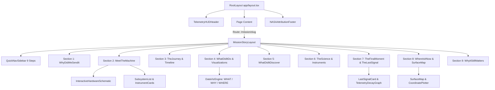
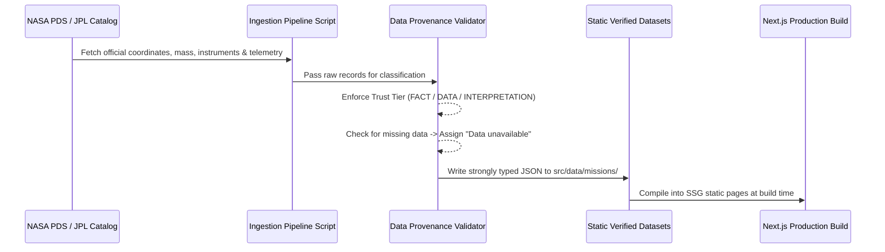

# TECHNICAL ARCHITECTURE — SPACE GRAVEYARD
> **"SPACE GRAVEYARD — The Machines We Left Behind"**  
> *2026 NASA Space Apps Challenge Full Technical Specification*

---

## 1. Folder Structure

```
space-graveyard/
├── public/
│   ├── assets/
│   │   ├── hardware/           # NASA hardware imagery & SVG schematics
│   │   ├── maps/               # Moon/Mars basemaps and GeoJSON layers
│   │   └── telemetry/          # Audio clips & raw telemetry snippets
│   └── favicon.ico
├── src/
│   ├── app/
│   │   ├── layout.tsx          # Root Layout (Space dark theme, HUD frame, Providers)
│   │   ├── loading.tsx         # Global Telemetry Loading Skeleton
│   │   ├── error.tsx           # Global Error Boundary UI
│   │   ├── not-found.tsx       # 404 Telemetry Lost UI
│   │   ├── page.tsx            # 1. Cinematic Homepage
│   │   ├── explorer/
│   │   │   └── page.tsx        # 2. Mission Explorer (Filterable catalog)
│   │   ├── mission/
│   │   │   └── [slug]/
│   │   │       ├── page.tsx    # 3-8. 9-Section Mission Story & Telemetry
│   │   │       ├── loading.tsx # Mission Detail Loading Skeleton
│   │   │       └── error.tsx   # Mission Detail Error State
│   │   ├── data-explorer/
│   │   │   └── page.tsx        # 9. NASA Data Explorer (Transparency & Provenance)
│   │   ├── education/
│   │   │   └── page.tsx        # 10. Education Mode & Quizzes
│   │   ├── sources/
│   │   │   └── page.tsx        # 11. Sources, Citations & Credits
│   │   └── api/
│   │       ├── missions/
│   │       │   ├── route.ts    # Filterable Mission Index Endpoint
│   │       │   └── [slug]/
│   │       │       └── route.ts # Individual Mission Detail Endpoint
│   │       └── datasets/
│   │           └── route.ts    # NASA Provenance Audit Endpoint
│   ├── components/
│   │   ├── common/             # Header, Footer, TelemetryHUD, SourceBadge, AudioPlayer
│   │   ├── homepage/           # HeroSection, FeaturedMissions, ChallengeBanner, StatsCounter
│   │   ├── explorer/           # MissionGrid, FilterBar, MissionCard, ActiveFilterChips
│   │   ├── story/              # NineSectionStoryLayout, StorySectionHeader, QuickNavSidebar
│   │   ├── hardware/           # MeetTheMachine, HardwareSchematic, SubsystemList, InstrumentCard
│   │   ├── timeline/           # MissionTimeline, TimelineNode, SilenceEventHighlight
│   │   ├── maps/               # SurfaceMap, PlanetaryCoordinatePlotter, RoverTraversePath
│   │   ├── dataviz/            # TelemetryChart, DistanceTraverseChart, InstrumentPayloadRadar
│   │   ├── signal/             # LastSignalCard, TelemetryDecayGraph, FinalLocationCoordinates
│   │   ├── data-explorer/      # DatasetProvenanceTable, TrustBadge, SourceLinkButton
│   │   └── education/          # EducationToggle, DidYouKnowCard, MissionQuizModal, GlossaryTooltip
│   ├── data/
│   │   ├── missions/           # Verified JSON datasets for Moon & Mars discarded hardware
│   │   │   ├── moon/           # Apollo 11, Apollo 15, Surveyor 3, LCROSS
│   │   │   └── mars/           # Opportunity, Spirit, InSight, Perseverance EDL
│   │   └── datasets.json       # Central provenance registry of all NASA datasets used
│   ├── context/
│   │   ├── EducationContext.tsx # Education mode toggle state provider
│   │   └── MotionContext.tsx    # Accessible reduced motion preference provider
│   ├── lib/
│   │   ├── data-loader.ts      # Query & filter static mission JSON files
│   │   ├── data-validator.ts   # Integrity checker for NASA provenance & facts
│   │   ├── coordinates.ts      # Moon (Lunar Planetographic) & Mars (IAU 2000) coordinate math
│   │   └── formatting.ts       # Date, distance, mass, and telemetry formatters
│   └── types/
│       ├── mission.ts          # Core Mission Record schema
│       ├── hardware.ts         # Component & Payload instrument schema
│       ├── timeline.ts         # Timeline milestone & event schema
│       ├── location.ts         # Celestial coordinate & traverse schema
│       └── provenance.ts       # NASA source & trust level schema
├── tailwind.config.ts
├── tsconfig.json
├── DEVELOPMENT_PLAN.md
└── package.json
```

---

## 2. Page Structure

| Route | Page Title | Primary Purpose | Key Components |
|---|---|---|---|
| `/` | **Cinematic Homepage** | Hook visitors, explain Space Apps Challenge, feature missions | `HeroSection`, `ChallengeBanner`, `FeaturedMissions`, `StatsCounter` |
| `/explorer` | **Mission Explorer** | Search & filter hardware by celestial body, type, status | `FilterBar`, `MissionGrid`, `MissionCard`, `ActiveFilterChips` |
| `/mission/[slug]` | **Mission Story Page** | Complete 9-section deep-dive into specific hardware | `NineSectionStoryLayout`, `MeetTheMachine`, `SurfaceMap`, `TheLastSignal` |
| `/data-explorer` | **NASA Data Explorer** | 100% transparent audit of all NASA data used | `DatasetProvenanceTable`, `TrustBadge`, `SourceLinkButton` |
| `/education` | **Education Mode** | Interactive learning, quizzes, and beginner terms | `EducationToggle`, `DidYouKnowCard`, `MissionQuizModal` |
| `/sources` | **Sources & Credits** | Full academic citations, PDS links, and image credits | `CitationList`, `ImageCreditGrid`, `NASAAttributionFooter` |

---

## 3. Component Hierarchy



---

## 4. Mission Data Schema (`src/types/mission.ts`)

```typescript
import { HardwareSpec } from './hardware';
import { TimelineEvent } from './timeline';
import { PlanetaryCoordinate } from './location';
import { NASAProvenance } from './provenance';

export type CelestialBody = 'Moon' | 'Mars';
export type HardwareType = 'Rover' | 'Lander' | 'Descent Stage' | 'Heat Shield' | 'Parachute' | 'Instrument Package' | 'Orbiter Impact';
export type MissionStatus = 'Abandoned' | 'Completed' | 'Silent';

export interface DiscoveryRecord {
  id: string;
  title: string;
  description: string;
  scientificSignificance: string;
  nasaImageRef?: string;
  provenance: NASAProvenance;
}

export interface LastSignalDetails {
  lastCommDate: string; // ISO Date String
  lastActivity: string;
  endingEvent: string; // e.g. "Global dust storm cut solar power generation"
  finalLocation: PlanetaryCoordinate;
  causeOfSilence: string;
  scientificLegacySummary: string;
  telemetrySnapshot?: {
    powerOutputWatts?: number;
    temperatureCelsius?: number;
    batteryPercentage?: number;
  };
  provenance: NASAProvenance;
}

export interface MissionRecord {
  id: string;
  slug: string;
  name: string;
  tagline: string;
  celestialBody: CelestialBody;
  hardwareType: HardwareType;
  status: MissionStatus;
  heroImage: string;
  heroImageAlt: string;
  
  // Section 1: Why Did We Send It?
  whyDidWeSendIt: {
    historicalContext: string;
    scientificGoals: string[];
    spaceEra: string;
  };

  // Section 2: Meet The Machine
  hardwareSpec: HardwareSpec;

  // Section 3: The Journey
  journey: {
    launchDate: string;
    landingDate: string;
    launchVehicle: string;
    landingSiteName: string;
    entryDescentLandingSummary?: string;
  };

  // Section 4: What Did It Do?
  operations: {
    summary: string;
    activeDurationDays: number;
    totalDistanceKm?: number;
    keyMilestones: string[];
  };

  // Section 5: What Did It Discover?
  discoveries: DiscoveryRecord[];

  // Section 6: The Science
  scienceImpact: {
    summary: string;
    dataTransmittedGB?: number;
    keyPublicationsCount?: number;
  };

  // Section 7: The Final Moment
  lastSignal: LastSignalDetails;

  // Section 8: Where Is It Now?
  locationNow: {
    coordinates: PlanetaryCoordinate;
    currentConditionEstimate: string;
    visibleFromOrbiter: boolean;
    orbiterImageryRef?: string;
  };

  // Section 9: Why Does It Still Matter?
  legacy: {
    engineeringInnovations: string[];
    futureMissionsInfluenced: string[];
    humanStorySummary: string;
  };

  timeline: TimelineEvent[];
  sources: NASAProvenance[];
}
```

---

## 5. Hardware Data Schema (`src/types/hardware.ts`)

```typescript
import { NASAProvenance } from './provenance';

export interface SubsystemComponent {
  id: string;
  name: string;
  category: 'Structure' | 'Power' | 'Communication' | 'Navigation' | 'Thermal' | 'Payload';
  description: string;
  materialComposition?: string;
  roleInMission: string;
}

export interface ScientificInstrument {
  id: string;
  name: string;
  acronym?: string;
  purpose: string;
  whatItMeasured: string;
  scienceEnabled: string;
  statusAtMissionEnd: 'Operational' | 'Degraded' | 'Single-Use Expired' | 'Failed';
  provenance: NASAProvenance;
}

export interface HardwareSpec {
  officialName: string;
  hardwareType: string;
  launchMassKg?: number;
  landingMassKg?: number;
  dimensionsMeters?: string;
  powerSource: 'Solar Panels & Battery' | 'RTG (Radioisotope Thermoelectric Generator)' | 'Chemical Battery' | 'Non-powered Hardware';
  components: SubsystemComponent[];
  instruments: ScientificInstrument[];
  schematicImageSvg?: string;
}
```

---

## 6. Timeline Data Schema (`src/types/timeline.ts`)

```typescript
import { NASAProvenance } from './provenance';

export type EventCategory = 'Launch' | 'Arrival' | 'Milestone' | 'Discovery' | 'Last Signal' | 'Mission End';

export interface TimelineEvent {
  id: string;
  date: string; // ISO Format (YYYY-MM-DD)
  title: string;
  description: string;
  category: EventCategory;
  isMajorHighlight: boolean;
  nasaRefUrl?: string;
  provenance: NASAProvenance;
}
```

---

## 7. Location / Coordinate Schema (`src/types/location.ts`)

```typescript
export type ReferenceFrame = 
  | 'Lunar Planetographic (IAU/IAG)' 
  | 'IAU Mars 2000' 
  | 'Planetocentric';

export interface PlanetaryCoordinate {
  latitude: number; // Decimal degrees
  longitude: number; // Decimal degrees (-180 to 180 or 0 to 360)
  regionName: string;
  featureName?: string; // e.g. "Hadley Rille", "Endeavour Crater", "Jezero Crater"
  celestialBody: 'Moon' | 'Mars';
  referenceFrame: ReferenceFrame;
  coordinateAccuracy: 'Exact Landing Telemetry' | 'Orbital Imaging Confirmed' | 'Estimated Drop Zone';
}

export interface TraverseWaypoint {
  solNumber?: number; // Mars Sol or Lunar Day
  date: string;
  coordinate: PlanetaryCoordinate;
  cumulativeDistanceKm: number;
  activityDescription?: string;
}
```

---

## 8. Image / Source / Credit Schema (`src/types/provenance.ts`)

```typescript
export type TrustClassification = 'FACT' | 'DATA' | 'INTERPRETATION';

export interface NASAProvenance {
  id: string;
  datasetName: string;
  nasaSource: string; // e.g., "NASA Planetary Data System (PDS)", "NASA JPL Photojournal", "NSSDCA Master Catalog"
  dataType: 'Telemetry Log' | 'Orbital Imagery' | 'Surface Photograph' | 'Instrument Data' | 'Mission Catalog';
  dateAccessed: string;
  url: string;
  attribution: string;
  trustClassification: TrustClassification;
  notes?: string;
}

export interface NASAMediaCredit {
  id: string;
  title: string;
  caption: string;
  creditText: string; // e.g. "NASA/JPL-Caltech/MSSS"
  sourceUrl: string;
  nasaImageId?: string; // e.g. "PIA24420"
}
```

---

## 9. API Architecture

Even though the platform leverages SSG (Static Site Generation) for optimum performance during judging, Next.js API routes are provided to support client-side filtering, data exploration, and dataset transparency audits:

- **`GET /api/missions`**: Query parameter filter interface (`?body=Mars&type=Rover&status=Silent`).
- **`GET /api/missions/[slug]`**: Returns full payload for a specific mission including telemetry decay curves.
- **`GET /api/datasets`**: Delivers complete provenance audit registry for `/data-explorer`.

---

## 10. NASA Data Ingestion Architecture



---

## 11. State Management Strategy

1. **URL-based State (Primary)**: Mission explorer filters (`body`, `type`, `status`) use Next.js `useSearchParams` and `useRouter` so search queries are deep-linkable and shareable.
2. **React Context (`EducationContext`)**: Global toggle for Education Mode (switching terminology complexity and enabling inline quiz badges).
3. **React Context (`MotionContext`)**: Tracks user's `prefers-reduced-motion` settings and provides accessible animation fallbacks.

---

## 12. Responsive Design Strategy

- **Mobile First**: Single-column layout for mobile (cards stacked vertically, accordion-style story navigation).
- **Tablet (md: 768px)**: 2-column grid for hardware components and split view for timeline nodes.
- **Desktop (lg: 1024px, xl: 1280px)**: Sticky sidebar navigation for 9-step story sections, side-by-side surface maps, and D3 visualization panels.

---

## 13. Animation Strategy

- **Cinematic Motion**: Subtile Framer Motion fades (`opacity: 0 -> 1`, `y: 20 -> 0`) triggered on scroll.
- **Telemetry Pulse FX**: Subtle glowing HUD borders on telemetry cards simulating live instrument panels.
- **Reduced Motion Support**: All motion hooks inspect `prefers-reduced-motion`. When enabled, transition duration drops to `0s` and opacity toggles instantly.

---

## 14. Error / Loading / Empty States

- **Loading States**: Custom telemetry-styled skeleton screen (`src/app/loading.tsx`) mimicking NASA control room data streams.
- **Error States**: `error.tsx` catching runtime exceptions with a diagnostic signal-loss display ("TELEMETRY SIGNAL LOSS: Diagnostic code 500").
- **Empty Filter States**: "No hardware matches query criteria" card with one-click reset button.
- **Missing Data**: Clear display of `"Data unavailable"` or `"Not confirmed"` badge—never silent nulls or fake placeholder facts.

---

## 15. Accessibility Strategy (WCAG 2.1 AA)

- **Keyboard Navigation**: Full focus trap management on quiz modals and interactive map popups. Visible focus rings (`focus-visible:ring-2 focus-visible:ring-amber-500`).
- **Semantic HTML**: Structural landmarks (`<main>`, `<section>`, `<article>`, `<nav>`, `<aside>`).
- **High Contrast**: Dark background (`#090D16`) with high-contrast text (`#F3F4F6`), achieving a 14:1 contrast ratio.
- **Screen Readers**: `aria-label` attributes on map controls, icon-only buttons, and status indicator lights.
- **Image Alt Texts**: Precise descriptions of NASA hardware photos and schematics (e.g. `alt="Apollo 11 Eagle Descent Stage resting on the lunar surface at Tranquility Base"`).

---

## Next Steps

The complete 15-part technical architecture and implementation roadmap (`DEVELOPMENT_PLAN.md`) are created. Standing by for your next command!
